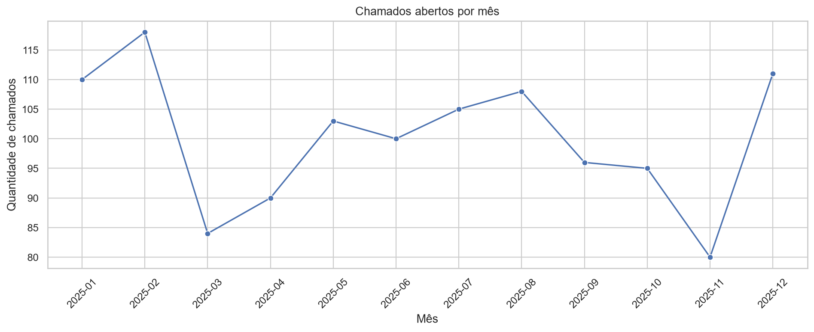
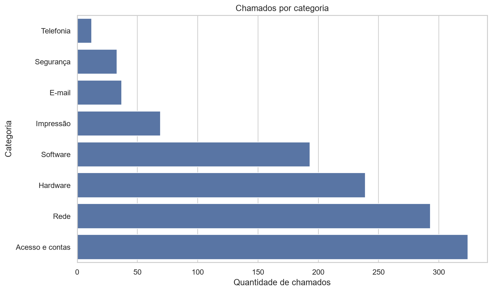

# IT Help Desk Analytics

Projeto de portfólio que simula uma solução de análise de chamados de suporte técnico. Usa Python, Pandas, NumPy, SQL e SQLite para organizar os dados, calcular indicadores e encontrar oportunidades de melhoria. Os gráficos são produzidos com Matplotlib e Seaborn; o dashboard é preparado para o Power BI.

> **Aviso:** os chamados, técnicos, departamentos e resultados são fictícios. O projeto demonstra uma metodologia de análise; não representa uma empresa real.

## Perguntas de negócio

- Quais problemas técnicos são mais frequentes?
- Quais departamentos abrem mais chamados?
- Qual é o tempo de resolução e o cumprimento do SLA?
- Quais chamados estão abertos e atrasados?
- Quais categorias mostram reincidência?
- Como estão a satisfação e a distribuição de carga entre técnicos?

## Principais resultados da amostra

- 1.200 chamados em 2025; 1.133 fechados e 67 abertos.
- Problema mais frequente: senha bloqueada, com 149 chamados.
- Departamento com maior volume: TI, com 164 chamados.
- Tempo médio para chamados fechados: 19,25 horas; mediana: 12,08 horas.
- SLA cumprido em 87,82% dos chamados fechados.
- Satisfação média: 4,01 de 5.
- Acesso e contas apresenta reincidência de 66,05% segundo a regra de até 30 dias no mesmo departamento e problema.

Os números são resultados da simulação. O indicador de volume fechado por técnico não mede qualidade individual sem considerar complexidade, prioridade e carga horária.

## Tecnologias

- Python, Pandas e NumPy
- SQLite e SQL
- Matplotlib e Seaborn
- Power BI (medidas DAX e guia de montagem)
- Git

## Estrutura

```text
data/          CSVs fictícios e tratados, SQLite e indicadores derivados
dashboard/     medidas DAX e guia para montar o relatório no Power BI
docs/          dicionário de dados e regras de análise
images/        gráficos exploratórios em PNG
notebooks/     notebook de análise exploratória
python/        scripts para gerar, tratar, explorar e analisar os dados
sql/           schema e consultas analíticas SQLite
```

## Preparação do ambiente

Com Python instalado, crie um ambiente virtual e instale as bibliotecas:

```powershell
python -m venv .venv
.venv\Scripts\Activate.ps1
pip install -r requirements.txt
```

## Executar o projeto

Na raiz do repositório, execute os scripts nesta ordem:

```powershell
python python\gerar_base.py
python python\tratar_base.py
python python\carregar_sqlite.py
python python\explorar_base.py
python python\analise_exploratoria.py
python python\executar_analises_sql.py
python python\calcular_indicadores.py
python python\gerar_recomendacoes.py
```

O banco SQLite é criado em `data/help_desk.db`. As consultas estão em `sql/analises.sql`. O script de gráficos atualiza os arquivos em `images/`, e os indicadores e recomendações são salvos em `data/`.

## Regras dos indicadores

- **Tempo médio de resolução:** diferença entre abertura e encerramento, em horas; inclui apenas chamados fechados.
- **SLA cumprido:** chamado fechado concluído dentro do prazo previsto para sua prioridade.
- **SLA fora do prazo:** chamados fechados marcados como `Não` divididos pelo total de fechados.
- **Chamado aberto atrasado:** chamado ainda aberto que passou do prazo na data de corte, 31/12/2025.
- **Reincidência:** mesmo departamento e descrição de problema com uma ocorrência anterior em até 30 dias. É um sinal para investigação, não prova de causa raiz comum.
- **Satisfação média:** média das notas preenchidas de 1 a 5 em chamados fechados.

## Power BI

O diretório `dashboard/` contém medidas DAX, um guia de montagem e uma especificação visual para carregar `data/chamados_help_desk_tratados.csv`, criar o calendário, configurar a relação de datas e montar duas páginas. Consulte [dashboard/guia_powerbi.md](dashboard/guia_powerbi.md) e [dashboard/especificacao_visual.md](dashboard/especificacao_visual.md). Este repositório ainda não inclui um `.pbix`; o relatório visual deve ser montado e salvo no Power BI Desktop.

## Gráficos exploratórios





Outros gráficos estão na pasta `images/`, incluindo distribuição por departamento, tempo de resolução por prioridade e satisfação.

## Aprendizados e próximos passos

O projeto separa dados originais e tratados, mantém nulos que representam chamados em andamento, documenta regras de negócio e combina consultas SQL com indicadores em Python. Uma evolução natural é substituir a simulação por dados anonimizados, testar os indicadores com usuários de negócio e ajustar os limites de alerta com base em histórico real.
